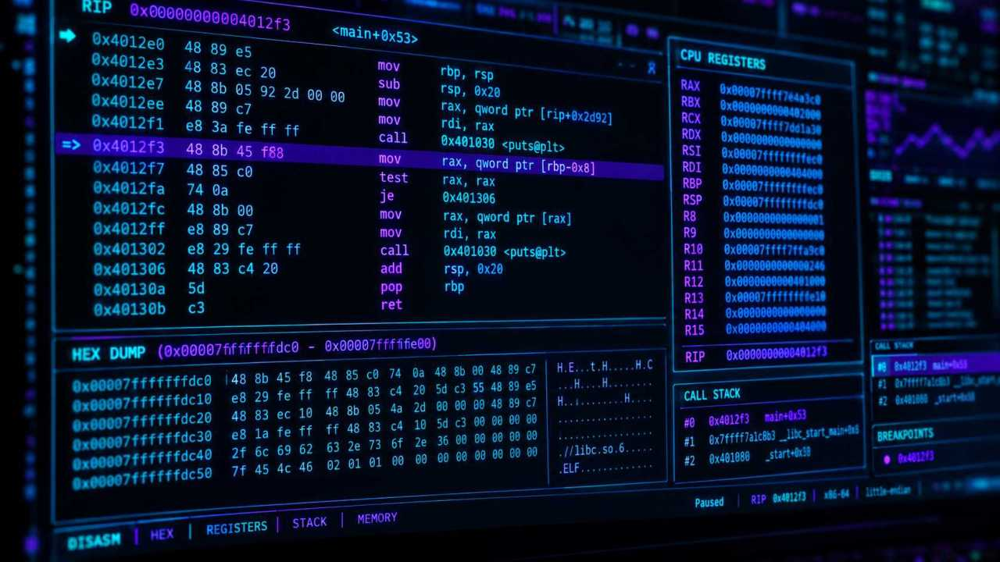

# Win64_Assembly_Lab

Win64_Assembly_Lab is a modular testing platform and research repository focused on low-level programming on Windows x64. Its goal is to provide security analysts and detection engineers with standalone, single-purpose components. Each component demonstrates an individual technique used by modern software threats when manipulating processes, bypassing standard API interfaces, and concealing their runtime behavior.

This lab allows you to reliably verify, in an isolated environment, whether your local security systems (AV, EDR, SIEM) correctly generate telemetry data and detect anomalous behavior of memory pages and system structures.

<div align="center">
  
  <small><i>Illustrative image generated using AI (OpenAI)</i></small>
</div>

## ⚠️ Important Security Notice

This project is intended solely for legitimate security research, education, and defensive system testing (Detection Engineering, Blue Teaming). The code in this repository is designed to validate the detection capabilities of security software in a controlled environment. The author assumes no responsibility for misuse of the described mechanisms or for any damage caused by running them outside a test lab.

## Library Architecture and Portability

Each technique is implemented as a fully self-contained module. The output of the build process is a static object library (.obj / .o) compiled in pure x64 assembly (NASM).

This approach eliminates dependency on specific compilers and guarantees universal portability. The libraries strictly follow the Windows x64 ABI calling convention (Microsoft x64 calling convention) and 16-byte stack alignment. This allows them to be directly and statically linked into projects in various languages:

- Pure x64 Assembly (NASM): Direct subroutine calls via the `EXTERN` directive.
- C / C++: Native object linking into utilities.
- Rust: Integration via the standard FFI interface in an `extern "win64"` block.
- Go / Golang: Static compilation supported through the Cgo linker.

## Published Modules

The following list contains the modules released so far and will be continuously expanded as new modules are added.

| Module | Component Name | Primary Analysis Target and Detection Telemetry |
| --- | --- | --- |
| 01 | Implicit Dynamic API Resolver | Detection of manual PEB/EAT parsing. Uses ROR13, DJB2, or hardware CRC32C hashes with recursive forwarding support. |

## Core Detection Layers

When emulating techniques from this lab, analyst teams focus on monitoring three fundamental areas:

1. **Memory Page Integrity (Memory Layer)**
Code running in memory often requires allocation of `PAGE_EXECUTE_READWRITE` permissions. Defenders must monitor telemetry for cases where executing code originates from a memory block with no corresponding mapping to a physical file on disk (so-called unbacked executable memory).

2. **Call Flow Integrity (Execution Flow)**
Code flow analysis via Stack Walking. Telemetry systems verify whether the call stack structure matches patterns produced by legitimate compilers and whether the RSP and RIP registers have been artificially modified. For unhooking-type techniques, the most common indicator is manual reading of system files from disk outside standard OS processes.

3. **Anomalous Structure Access (Structural Access)**
Based on the fact that regular software accesses the library lists in the PEB (InLoadOrderModuleList) only rarely. If a process repeatedly traverses these internal tables or manually parses export directories outside the system loader (ntdll.dll), this constitutes anomalous process behavior.

## Working with the Lab

Each module has its own subdirectory containing source code and a ready-to-use Makefile. The MinGW-w64 toolchain and NASM assembler must be installed to build the environment.

```bash
# Clone the lab repository
git clone https://github.com/Proteqtum/Win64-Assembly-Lab/
cd Win64-Assembly-Lab

# Navigate to a specific module directory (e.g. Module 01)
cd modules/01_Dynamic_API_Resolver

# Automatically compile all test variants at once via Makefile
make
```

After running the binaries, we recommend monitoring the output in your local EDR console. Verify that the system correctly generated the expected alerts.

## Notes

**Localization:** The original documentation and research notes were authored in Czech and reviewed with the assistance of AI-based language tools to ensure clarity and accuracy of the English translation.
